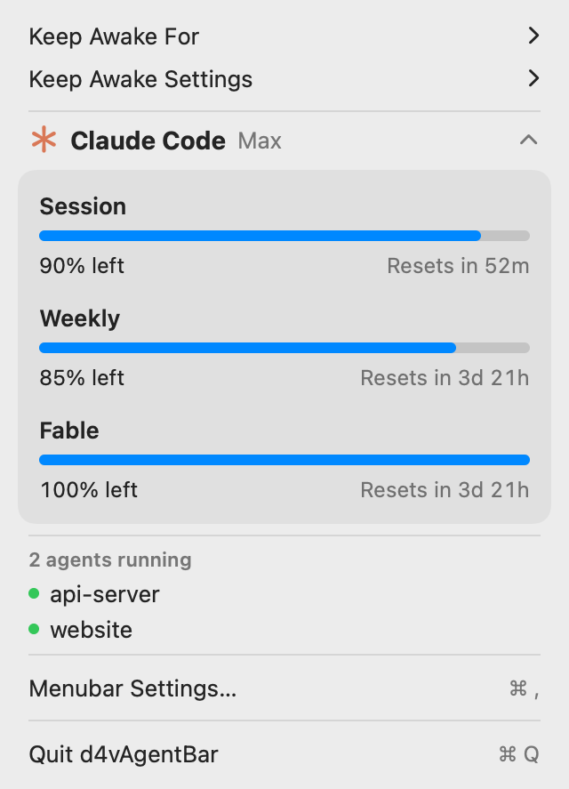

# d4vAgentBar

Petite app de barre de menus macOS qui affiche les quotas Claude Code (session, semaine, limite par modèle), permet de garder le Mac éveillé et liste les sessions `claude` en cours.



## Comment ça marche

Les quotas viennent du CLI Claude Code lui-même :

```bash
claude -p "/usage" --output-format json --no-session-persistence
```

C'est une commande locale : aucun appel au modèle, aucun quota consommé. L'app lit les lignes `Current session: 8% used · resets …` et calcule le temps restant avant réinitialisation. Rafraîchissement toutes les 5 minutes (réglable) et à l'ouverture du menu.

- **Keep Awake For** : assertion IOKit (comme `caffeinate`) pour 15 min → 8 h ou sans limite, avec ou sans l'écran.
- **Agents** : processus `claude` en cours, avec le nom de leur dossier de travail.
- **Settings (⌘,)** : pourcentage dans la barre de menus, fréquence de rafraîchissement, lancement à l'ouverture de session.

## Prérequis

- macOS 14 ou plus, Swift 6 (Xcode ou Command Line Tools)
- Claude Code installé et connecté (`claude auth status`)

## Compiler et installer

```bash
./build-app.sh            # crée build/d4vAgentBar.app
./build-app.sh --install  # copie dans /Applications et lance l'app
```

Tests du parseur :

```bash
swift test
```

Capture du menu sans l'ouvrir (avec des agents fictifs grâce à `--demo`) :

```bash
build/d4vAgentBar.app/Contents/MacOS/d4vAgentBar --snapshot docs/screenshot.png --demo
```

## Limite

La sortie de `/usage` est faite pour être lue, pas un format stable : si une version de Claude Code la change, le menu affiche « Unrecognised /usage output » et il faut adapter [`UsageParser.swift`](Sources/D4vAgentBar/UsageParser.swift).
